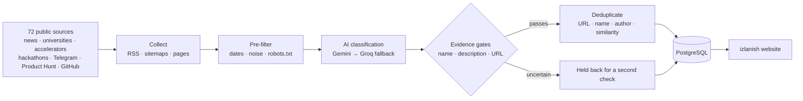

<div align="center">

# 🌱 Startup Finder — izlanish.

**An AI-assisted catalog of real startups and projects, built for Uzbekistan and beyond.**

Every card links back to its original source. Facts come from sources, and AI analysis is kept separate.

[**🌐 Live site**](https://startup-finder-32ac.onrender.com) · [How it works](#-how-it-works) · [Tech stack](#-tech-stack) · [Run locally](#-running-locally)


</div>

---

## 📖 About

**Startup Finder** is the project. **izlanish** ("search" or "exploration" in Uzbek) is the website it powers.

New products, startups and prototypes from Uzbekistan get announced all over the place: news sites, university pages, accelerator programs, hackathon results, Telegram channels. Almost none of them are collected in one place. izlanish searches these sources every day and checks that each find is a real project. The ones that pass become short, readable cards that always link to the original source.

The site's interface is in **Uzbek**. Section names and buttons in this README are written in English, with the label used on the site in brackets, for example *Projects* (“Loyihalar”).

### What makes it different

- **Real projects only.** A card needs a concrete project name, a meaningful description and a verifiable source URL. The site never adds made-up or filler cards to fill the feed.
- **Facts and AI are kept apart.** Facts on a project page are quoted from the source. Any AI interpretation sits in a separate, clearly labeled *Detailed analysis* (“Batafsil tahlil”) block that is never presented as fact.
- **Honest dates.** Projects are dated by when the source published them, not by when the bot found them. If the date can only be estimated, the card says so (“Topilgan: …”, *found on*).
- **Runs on free tiers.** Discovery, AI classification and hosting all use free plans, with strict daily request budgets so nothing incurs a paid bill.

---

## ✨ Features

| Page | What it does |
|---|---|
| 🏠 **Home** (“Bosh sahifa”) | Today's new projects (“Bugungi loyihalar”). If nothing came in today, the most recent day's projects (“So‘nggi loyihalar”). Also shows counters for the whole catalog and for Uzbekistan, Global and GitHub. |
| 📚 **Projects** (“Loyihalar”) | The full catalog. Has a name search (“Qidirish”) and compact filter chips: **period** (“Barcha vaqt” / “So‘nggi paytda”), **year** (“Yil”) and **section** (“Bo‘lim”: O‘zbekiston, Global, GitHub, Boshqa). Options open in a panel right under the chips, and each one shows how many projects it contains (“12 ta”). |
| ❔ **Other** (“Boshqa”) | Valid projects whose country or section couldn't be determined reliably. Each card explains why. |
| 🗂️ **Archive** (“Arxiv”) | Older projects, sorted by the source's original publication date and filterable by year. |
| 🔗 **Sources** (“Manbalar”) | The public list of every source the site watches, grouped by type. |
| 📄 **Project page** | What the project does (“Loyiha nima qiladi?”), the original sources (“Asl manbalar”), verified key facts with the original quotes (“Tasdiqlangan asosiy faktlar”), and an optional AI analysis block. |

**“So‘nggi paytda”** (*recently*) is a week-based filter. From Monday to Wednesday it shows last week's projects. From Thursday on it switches to the current week. That way the filter is never nearly empty at the start of a week.

The layout is responsive and designed mobile-first. It has a dark theme with a mint accent.

---

## ⚙️ How it works



1. **Collect.** A scheduled GitHub Actions job runs every evening at 20:00 Tashkent time. It reads RSS feeds, sitemaps and pages from a registry of **72 sources**:
   - Uzbek news sites: Spot, Kun.uz, Gazeta.uz, Daryo
   - universities, IT Park, accelerators and hackathon sites
   - Telegram channels
   - global launch platforms: Product Hunt, BetaList, Show HN, Y Combinator, GitHub

   The collector respects `robots.txt` and per-source limits.
2. **Filter.** Pages without a reliable publication date, future-dated pages and obvious noise are dropped before any AI call is spent.
3. **Classify.** An LLM (Google **Gemini**, with **Groq** as a fallback) decides whether the page describes a real project. It extracts the name, creator and sector, and writes a short Uzbek description. Responses are validated against a strict JSON schema. Names and links are checked against the source text.
4. **Verify.** Mandatory evidence gates check for a named project, a substantive description and a working source URL. Anything uncertain is held back and checked again instead of being published.
5. **Deduplicate.** URLs, names, creators, aliases and description similarity are compared, so the same project found in two places becomes one card with several sources.
6. **Publish.** Up to a daily target of new projects (currently 8) is published. A catalog score out of 10 ranks the cards.

**Running safely on free tiers**

- **Hard budgets.** Every run has limits on pages, candidates, LLM requests and tokens per run and per day. A circuit breaker stops calling a provider after repeated failures.
- **One writer at a time.** A database lease means only one job writes at once.
- **Weekly encrypted backups.** A separate workflow takes a database backup every week and encrypts it with GPG.

---

## 🛠 Tech stack

| Layer | Technologies |
|---|---|
| **Frontend** | React 19, TypeScript, Vite, React Router, Lucide icons |
| **Backend** | Python 3.12, FastAPI, Pydantic, SQLAlchemy 2, httpx, BeautifulSoup, feedparser, Protego (`robots.txt`) |
| **Database** | PostgreSQL with row-level security. SQLite is used only in isolated tests. |
| **AI** | Google Gemini (primary) and Groq (fallback), both free-tier with enforced quotas |
| **Automation** | GitHub Actions: daily discovery, weekly encrypted backup, CI |
| **Deployment** | One Docker image: the built frontend is served by FastAPI |
| **Testing** | pytest, Ruff, Playwright end-to-end tests on desktop and mobile (iPhone 13) viewports, PostgreSQL regression suite |

---

## 📁 Project structure

```text
startup-finder/
├── backend/app/          # FastAPI app, discovery pipeline, AI classification, dedup, ranking
│   └── collectors/       # RSS / sitemap / page collectors and parsers
├── frontend/             # React + TypeScript site (Vite)
│   ├── src/              # pages, components, styles
│   └── e2e/              # Playwright tests (desktop + mobile)
├── config/
│   ├── sources.json      # registry of watched sources
│   └── prompts/          # versioned LLM prompts
├── tests/                # pytest suite
├── scripts/              # setup, start, checks, backup, deployment verification
├── docs/                 # design notes, operations and validation reports
├── .github/workflows/    # CI, daily discovery, weekly backup, Postgres regression
└── Dockerfile            # single image: builds the frontend, serves it with FastAPI
```

---

## 🚀 Running locally

**Requirements:**

- Python 3.12+
- Node.js 24 with npm
- [uv](https://docs.astral.sh/uv/)
- a PostgreSQL database

**1. Install and configure**

```bash
git clone https://github.com/Cos1mo0919/startup-finder.git
cd startup-finder
cp .env.example .env        # then fill in DATABASE_URL and, optionally, AI keys
./scripts/setup.sh          # installs Python + npm deps and builds the frontend
```

**2. Prepare the database schema** (run once on a new database)

```bash
.venv/bin/python -m backend.app.schema
```

**3. Start the site**

```bash
./scripts/start.sh          # serves the site and the API on http://localhost:8000
```

For frontend development, run the API with `uvicorn backend.app.main:create_app --factory --reload` and `npm run dev` in `frontend/`. Vite proxies `/api` to the backend.

**Run all checks** (Ruff, pytest, frontend build, Playwright):

```bash
./scripts/check.sh
```

> AI keys are optional. Without them the site still works, and new finds are held back until a key is configured. Secrets belong in your environment or hosting settings, never in Git. See [`.env.example`](.env.example).

---

## 🗺 Roadmap

- [x] Uzbekistan catalog with verified sources
- [x] Global and GitHub sections
- [x] Free, budgeted daily discovery
- [x] Weekly encrypted backups
- [ ] More regional sources (Central Asia)
- [ ] Problem → solution insights for visitors

---

## 📚 Further reading

- [`ARCHITECTURE.md`](ARCHITECTURE.md): how the system is designed
- [`docs/FREE_DAILY_OPERATIONS.md`](docs/FREE_DAILY_OPERATIONS.md): how the free daily run and its budgets work
- [`docs/DEVELOPMENT_NOTES.md`](docs/DEVELOPMENT_NOTES.md): detailed development log (in Russian)

---

## 👤 Author

Built by [@Cos1mo0919](https://github.com/Cos1mo0919).

Have a project that should be on izlanish, or found a mistake? Feel free to [open an issue](https://github.com/Cos1mo0919/startup-finder/issues).

## 📄 License

© 2026 Cos1mo0919. All rights reserved. The source code is published for viewing and reference.
